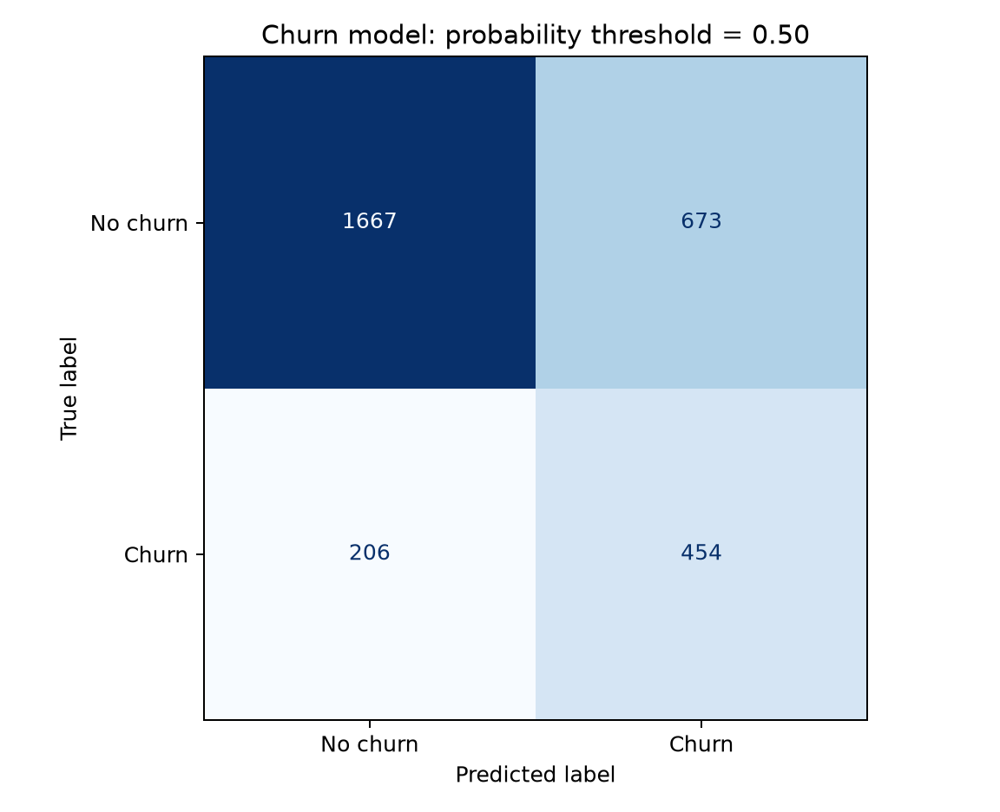
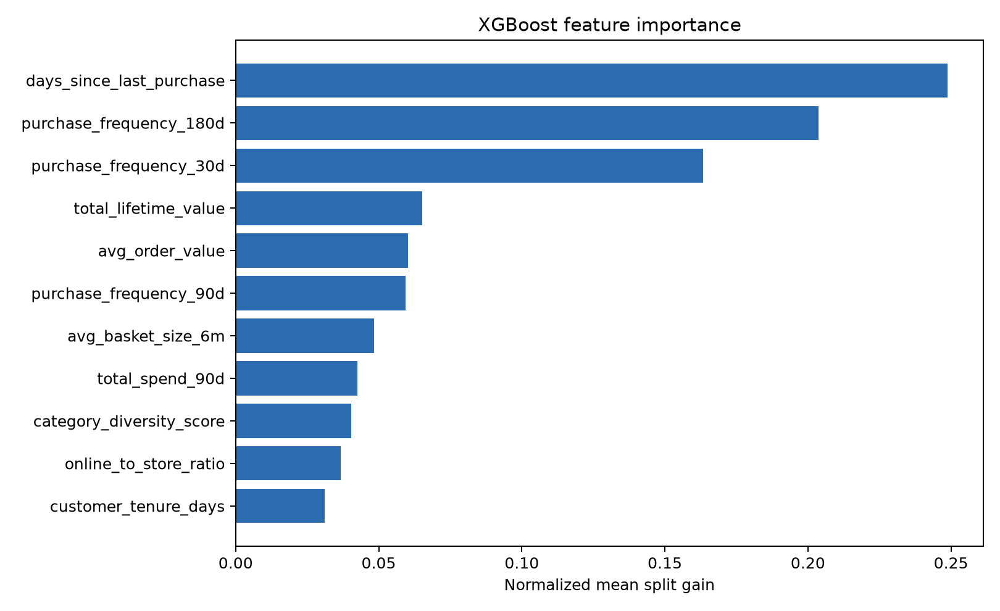

# Lab 3 — Churn Model Evaluation

## Data and model

I queried the Lab 2 Feature Store offline table through Athena using my own IAM user. The query returned 9,999 unique customers in customer-ID order. I used 11 numeric input features; customer ID, loyalty tier, the label, and the rule-based `churn_risk_score` were excluded from the model inputs.

The stratified 70/30 split used `random_state=42`: 6,999 training customers and 3,000 validation customers. The validation set contains 660 churners. XGBoost 3.2.0 used `max_depth=6`, `eta=0.1`, at most 200 rounds, and a training-set class weight of `5459/1540 = 3.544805194805195`. AUC-based early stopping retained the best 11 rounds.

## Aggregate results

| Metric | Result | Course requirement |
|---|---:|---|
| Full-model AUC-ROC | 0.7838 | Report the value |
| Recency-only baseline AUC | 0.7229 | Train on the same split |
| AUC lift | +0.0609 | Report the difference and its CI |
| Paired bootstrap 95% CI for lift | [0.0415, 0.0802] | Lower bound above zero — PASS |
| Precision at top 10% | 0.7133 | At least 0.50 — PASS |
| Recall at top 10% | 0.3242 | At least 0.25 — PASS |

The contact budget is exactly 300 customers. The model found 214 churners in this group: precision is `214/300`, and recall is `214/660`. Scores are sorted descending, with ties resolved by the fixed validation-row order. The percentile-based starter implementation also selected exactly 300 customers in this run.

The baseline is a separate XGBoost model trained only on `days_since_last_purchase`, using the same training and validation customers. It is not a constant predictor. For the confidence interval, I resampled validation-row indices with replacement 2,000 times using seed 42. Each replicate used the same sampled rows for both models. I took the 2.5th and 97.5th percentiles of the AUC differences. The interval excludes zero, supporting an improvement from the full feature set on this split.

## Loyalty-tier slices

Recall below uses each tier's churners captured in the single global top-300 contact list. It does not allocate a separate 10% budget to every tier.

| Tier | n | Positives | AUC | Recall | Selected | True positives | Small-sample warning |
|---|---:|---:|---:|---:|---:|---:|---|
| Bronze | 1,071 | 361 | 0.7580 | 0.4183 | 186 | 151 | No |
| Silver | 1,139 | 226 | 0.7214 | 0.2389 | 101 | 54 | No |
| Gold | 483 | 52 | 0.7501 | 0.1346 | 10 | 7 | No |
| Platinum | 307 | 21 | 0.8964 | 0.0952 | 3 | 2 | Yes |

Silver has the lowest within-tier AUC. Gold and Platinum recall are more than 10 percentage points below aggregate recall and are flagged for review. Platinum has the highest observed AUC but only 21 positives; its recall is based on finding two of them. My descriptive small-sample warning is `n < 100` or fewer than 30 examples in either class. These tier differences need more evidence before a strong conclusion. A tier-specific contact allocation could change coverage, but it would be a different business policy that needs evaluation.

The full table is in [slice-evaluation.csv](lab3-evidence/slice-evaluation.csv).

## Confusion matrix and feature importance

At a probability threshold of 0.50, the model has 1,667 true negatives, 673 false positives, 206 false negatives, and 454 true positives. This threshold-based classification is separate from the top-300 contact budget above.

Recency contributes 24.9% of normalized mean split gain, followed by 180-day purchase frequency at 20.4% and 30-day frequency at 16.3%. Tenure, online/store ratio, and category diversity have smaller gain shares. Gain describes this fitted model, not causal importance; the baseline comparison tests the added feature set jointly, not each feature separately.

## Limitations and evidence

The same 30% split was used for early stopping and parameter comparison, following the starter setup. The paired CI is conditional on this selected model and split; it does not include model-selection uncertainty. An untouched test set would provide a stronger generalization check.

- [Metrics JSON](lab3-evidence/evaluation_metrics.json)
- [Selected final training output](lab3-evidence/train-final.log)
- [Run and model lineage](lab3-evidence/training-lineage.json)
- Athena QueryExecutionId: `a4a936c4-dcbe-46d7-bf7c-d2d1627e6c9f`
- MLflow Run ID: `6d3dfd0d527543feafe2d37712a54b92`

The evaluated model is registered as version **1** in `northstar-churn-models`, with package status `Completed` and approval status **`PendingManualApproval`**. Its ARN is `arn:aws:sagemaker:us-east-1:173506956686:model-package/northstar-churn-models/1`. All evaluation values are preserved in `CustomerMetadataProperties` and match this report, the metrics JSON, and the selected MLflow run.

Registration was performed after the selected training run, using the unchanged model file (SHA256 `8ef39c2469667a6e718318826294962f88679b4ac30c3c259ea1d6b88a1d95dc`). `train-final.log` is a byte-for-byte copy of that run's original `train-evaluation.log`; the historical registration TODO in it records the code state at training time. The actual later registration output is in [model-registration.log](lab3-evidence/model-registration.log). No retraining or replacement of the MLflow training-source artifact was needed.

The inference bundle uses the official XGBoost `3.2-0` image pinned by ECR digest, a native UBJSON model, its feature order and lineage, and a custom framework handler. Reading the registered S3 bundle back and invoking its handler locally reproduced all 3,000 validation probabilities exactly. Ordered JSON, named feature records, CSV, and input validation were checked. No endpoint was deployed and full container startup has not been tested. See [model-registry.json](lab3-evidence/model-registry.json) and the [independent registry verification](lab3-registry-check.json).
